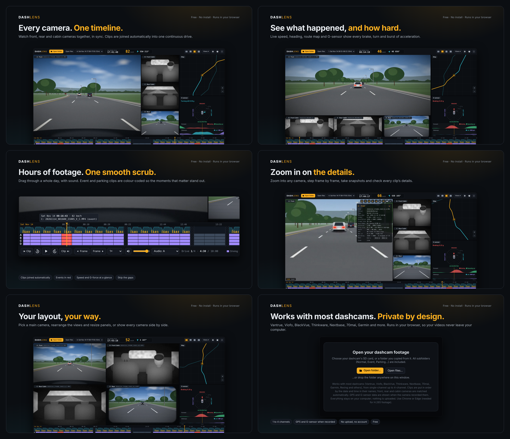

# DASHLENS

### Because apparently, making a functional dashcam viewer is fucking rocket science.

You bought a dashcam to document other people's questionable decisions, only to discover that the manufacturer made a few of its own.

You wanted to watch a video. Instead, you got unresponsive controls, questionable interfaces, and the privilege of opening clips individually like a medieval librarian sorting evidence of witchcraft.

So, out of spite, DASHLENS was born.

DASHLENS is a completely free, browser-based, multi-channel dashcam viewer built around a revolutionary engineering principle: **shit should just work.**

No account. No installation. No footage uploads. No sacrificing a goat to synchronize four cameras.

It just sits there, quietly doing its fucking job. A concept apparently lost on an entire industry.

## What does this magnificent bastard do?

- **Synchronized multi-camera playback:** Witness stupidity from up to four different perspectives simultaneously.
- **Automatic file organization:** Drop in your entire SD card. It'll sort through the digital landfill itself.
- **Duplicate detection:** Backup folders, `clip (1).mp4` and half-finished copies get hidden, so nothing plays twice. Your files on disk are never touched.
- **Interactive GPS map:** See exactly where shit went sideways. Geographically.
- **Speed and heading display:** Quantify questionable decisions.
- **G-force visualization:** Observe the physical consequences of those decisions.
- **Unified timeline:** Navigate driving, parking and event recordings without developing a personal vendetta against your file explorer.
- **Up to 16× playback:** Because not every second of your commute deserves a documentary.
- **Frame-by-frame navigation:** Examine the precise moment someone's last functioning brain cell resigned.
- **Customizable camera layouts:** Resize, rearrange, zoom, mirror and flip things until your inner control freak achieves inner peace.
- **Snapshots:** Preserve particularly distinguished moments of human incompetence.
- **Jump to the events:** "Next event", "Previous event" and a list with the time, peak g and speed, so you don't scrub through 40 minutes of motorway to find the one second that matters.
- **Save evidence:** One click saves an evidence folder: the moment from every camera as one video file (with the time, speed and G-force on it), a printable incident summary, exact copies of the original files, the GPS route, and SHA-256 checksums of everything. Your original files stay untouched.
- **Straight to the point:** After loading, DashLens shows the strongest moment in the footage and says why it picked it. Hover over the timeline to see the frame under the pointer.
- **Pins:** Press P to pin a moment and write a note on it. Pins, with a picture of the frame, go into the incident summary.
- **Pick up where you left off:** Open the same footage again and DashLens offers to go back to where you stopped, with your pins and clip range. This is kept in your browser only.
- **Telemetry as CSV:** Speed, position, heading and G-force, one row for each reading the camera recorded, ready for a spreadsheet.
- **Tesla support:** TeslaCam folders (RecentClips, SavedClips, SentryClips) with all cameras, and the speed, position, G-force, brake, turn signals, gear and Autopilot state that Tesla firmware 2025.44.25 or later writes into every frame.
- **Privacy you can check:** The "Private" status counts every internet request the page makes, and tells you how to check it yourself.
- **Local processing:** Your footage stays on your computer. Your questionable karaoke sessions are nobody else's business.

## Why pay when you can have it for free?

You've already paid for the dashcam, the SD card, the car, and insurance against people who apparently obtained their driver's licence from a cereal box.

And now you're supposed to pay to watch your own fucking videos?

DASHLENS is free. All of it.

No subscriptions. No trial periods. No activation keys. No premium features held hostage behind a paywall. No DASHLENS Pro Max Ultra Platinum Fucking Deluxe Edition.

Spend your money on gas, coffee, another SD card, or literally anything other than the privilege of watching footage you already own.

**You've already paid to record the bullshit. You shouldn't have to pay to watch it.**

## Getting started

### Option 1: Use it online

**[Launch DASHLENS](https://dashlens.vercel.app/)**

Open the link in your browser and select your dashcam's SD card, a folder containing your recordings, or individual video files. You can also drag and drop your footage into the viewer.

### Option 2: Run it locally

1. Download [`index.html`](./index.html) from this repository.
2. Open the file in Chrome or Edge.
3. Select your footage and press play.

That's it. No installer, terminal commands, dependencies to install, or bullshit involving a Docker container just to watch some bloke miss an exit.

## Compatibility and privacy

DASHLENS is designed to work with common dashcam recording conventions, from single-camera setups to four-channel systems. Compatibility depends on the recording format, filename conventions and browser decoding support.

- GPS and G-sensor displays require compatible recorded telemetry. Tesla telemetry needs firmware 2025.44.25 or later and HW3 or later; parked (Sentry) clips may have none.
- H.265/HEVC playback requires compatible browser and system decoding support.
- Online map tiles require an internet connection and are fetched from external map providers; your video files are processed locally in your browser and are not uploaded by DASHLENS. One switch turns the map tiles off, and then nothing at all is loaded from the internet.
- Local video playback does not require an internet connection.

## Frequently Unasked Questions

**Why did you make this?**

Spite. Frustration. An unreasonable expectation that software should perform its intended function.

**Does DASHLENS stand for something?**

Officially, it's a perfectly respectable product name.

Unofficially:

**D**ocumenting **A**ssholes' **S**tupid **H**abits: **L**egally **E**mbarrassing **N**onsense **S**torage.

The marketing department was not consulted. There is no marketing department.

**Is it actually free?**

Yes. There is no financial ambush waiting behind the fourth camera.

**Will this make people better drivers?**

No. It will make their incompetence considerably easier to navigate.

---

**Open it. Scrub it. Investigate it. Judge silently.**

*Human stupidity is inevitable. Shitty software doesn't have to be.*

---

## License

[MIT](LICENSE) © 2026 drGrey32
